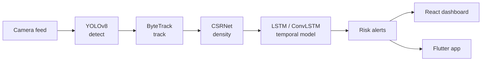
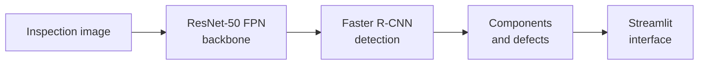
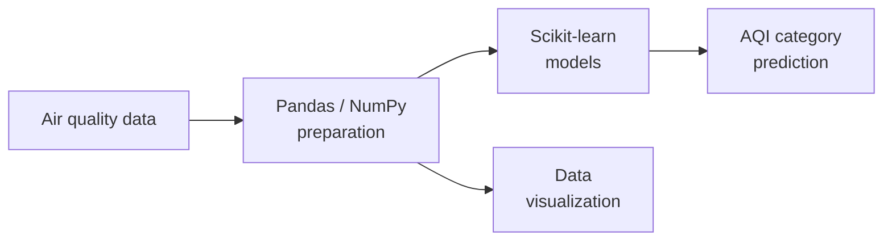

<div align="center">

```text
┌────────────────────────────────────┐
│  FIELD NOTES // VISION LAB         │
│  ────────────────────────────────  │
│  operator   Pabitra Panda          │
│  base       Bhubaneswar, India     │
│  focus      AI · ML · Vision       │
│  status     building, logging      │
└────────────────────────────────────┘
```

# Pabitra Panda

**I build systems that look at the world and say something useful about it.**

<sub>MCA · Artificial Intelligence · Machine Learning · Computer Vision · Data Science</sub>

<br>

[`Experiments`](#-01--experiments) · [`Instruments`](#-02--instruments) · [`Background`](#-03--background) · [`Contact`](#-04--signal)

</div>

<br>

---

## ▍00 · Abstract

> I teach machines to look at crowds, at power lines, at the air, and to turn what they see into decisions people can act on.

I'm an MCA student and aspiring **AI/ML Engineer** who likes the full path from raw signal to working interface: collecting and cleaning data, training models, and wrapping them in something a person can use. These notes document the experiments I'm most proud of, plus the tools I work with.

**Currently aiming for:** AI/ML Engineer · Python Developer · Software Developer roles.

<br>

---

## ▍01 · Experiments

Three entries from the lab log, each following a **signal → model → decision** pipeline.

<br>

### ◉ EXP-01 &nbsp;/&nbsp; CrowdShield AI

**Intelligent Multimodal Crowd Monitoring and Safety System**

A crowd-safety platform that detects people, tracks their movement, estimates crowd density, and flags risky situations. It supports operators through a web dashboard and a mobile app.



<details>
<summary><b>Stack & architecture notes</b></summary>

<br>

| Layer | Tools |
| :-- | :-- |
| Vision & models | `YOLOv8` · `ByteTrack` · `CSRNet` · `LSTM / ConvLSTM` |
| Backend | `Python` · `FastAPI` · `Spring Boot` |
| Interfaces | `React` (dashboard) · `Flutter` (mobile) |
| Data | `PostgreSQL` · `Redis` |

</details>

<!-- Add the repository link here when it is public:
**Repository:** [PabitraPanda05/CrowdShield-AI](https://github.com/PabitraPanda05/CrowdShield-AI) -->

<br>

### ◉ EXP-02 &nbsp;/&nbsp; VoltVision AI

**AI-Powered Power Line Inspection and Automated Defect Detection**

A deep learning system for inspecting power line components and detecting defects automatically, meant to take some of the repetitive visual checking out of infrastructure inspection.



<details>
<summary><b>Stack</b></summary>

<br>

`Python` · `PyTorch` · `Faster R-CNN` · `ResNet-50 FPN` · `OpenCV` · `Streamlit`

</details>

**Repository:** [PabitraPanda05/VoltVision-AI](https://github.com/PabitraPanda05/VoltVision-AI)

<br>

### ◉ EXP-03 &nbsp;/&nbsp; AirGuard AI 2.0

**Machine Learning Framework for Air Pollution Detection and AQI Category Prediction**

A classical ML workflow that studies air-quality data and predicts AQI categories, with visual analysis alongside the models.



<details>
<summary><b>Stack</b></summary>

<br>

`Python` · `Pandas` · `NumPy` · `Scikit-learn` · `Machine Learning` · `Data Visualization`

</details>

**Repository:** [PabitraPanda05/AirGuard-AI-2.0](https://github.com/PabitraPanda05/AirGuard-AI-2.0)

<br>

---

## ▍02 · Instruments

These are the tools I use and am growing with. They're listed by category, not ranked by mastery.

<table>
  <tr>
    <td width="50%" valign="top">

**Languages**<br>
`Python` `Java` `C` `JavaScript`

**Intelligence**<br>
`Machine Learning` `Deep Learning` `Computer Vision`<br>
`PyTorch` `Scikit-learn` `OpenCV`<br>
`YOLO` `Faster R-CNN`

**Data**<br>
`Pandas` `NumPy` `Matplotlib` `Seaborn` `Plotly`

  </td>
  <td width="50%" valign="top">

**Interfaces & Services**<br>
`HTML` `CSS` `JavaScript` `Bootstrap`<br>
`React` `FastAPI` `Spring Boot`

**Storage**<br>
`MySQL` `PostgreSQL` `SQLite`

**Workbench**<br>
`Git` `GitHub` `VS Code` `Jupyter Notebook`<br>
`Anaconda` `IntelliJ`

  </td>
  </tr>
</table>

<br>

---

## ▍03 · Background

```text
MCA            Centurion University of Technology and Management, Bhubaneswar
B.Sc. (CS)     Vikram Dev University
CGPA           8.95
```

<br>

---

## ▍04 · Signal

<div align="center">

If you're working on something in AI, vision, or applied ML, or just want to compare notes, send a signal.

<br>

[](mailto:pabitra200369@gmail.com)
&nbsp;
[](https://github.com/PabitraPanda05)

<br>

<sub>▍ end of log · more entries coming ▍</sub>

</div>

<!--
OPTIONAL: add GitHub stats later, once there's enough activity to show.
Uncomment and keep it to one widget.

<div align="center">
  
</div>
-->
